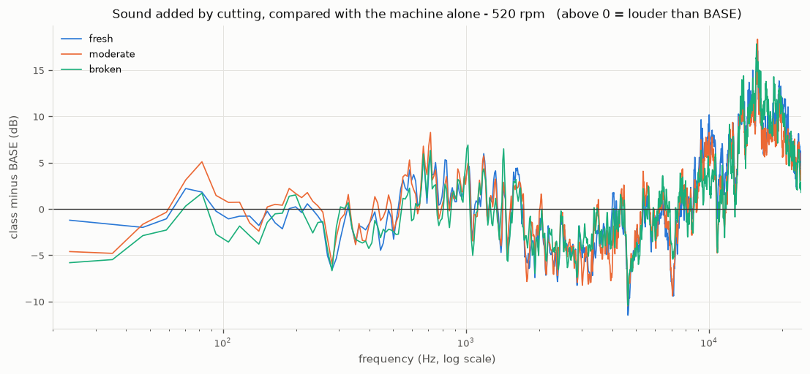
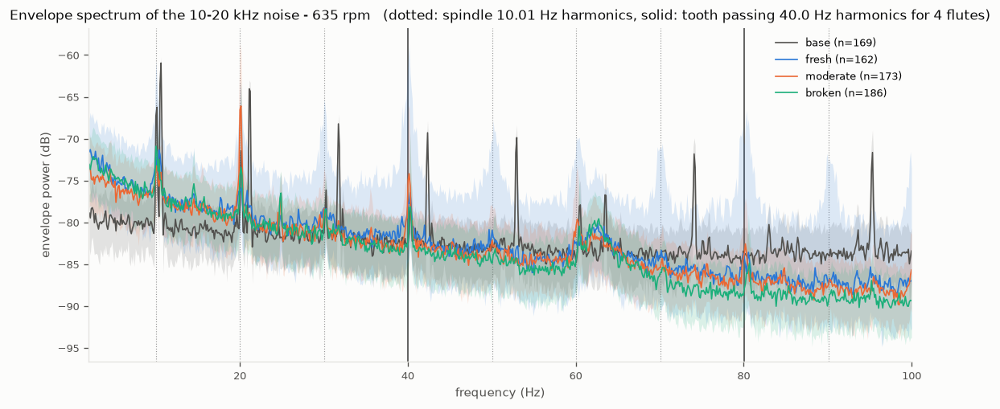
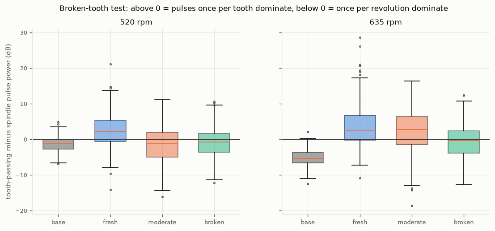
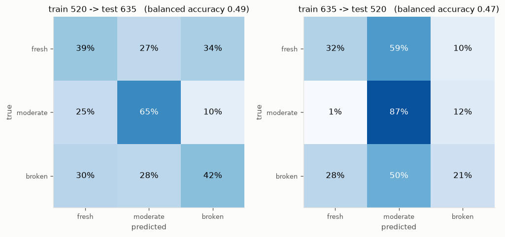
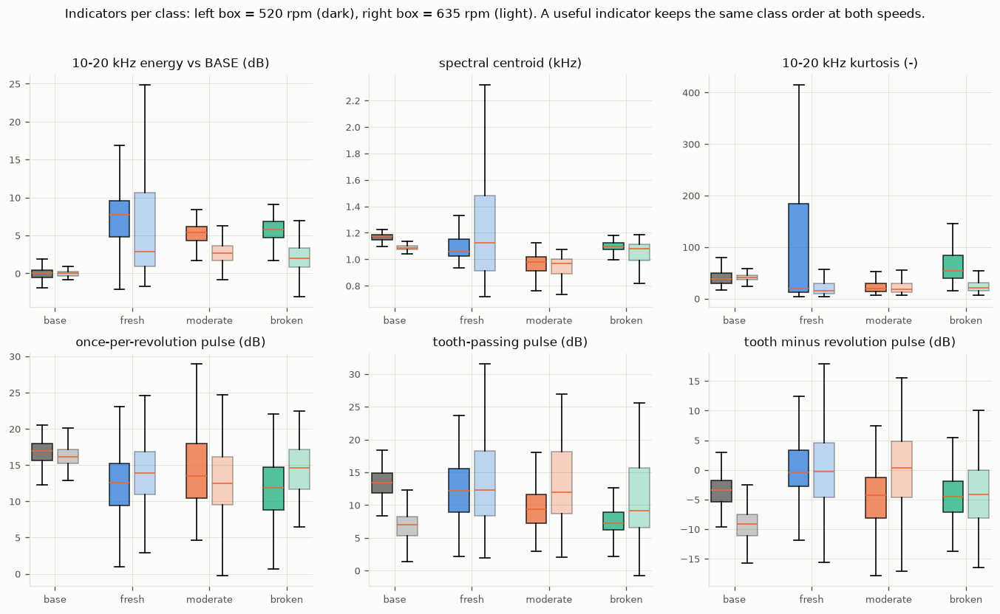

# Tool condition from sound only: end milling of mild steel

**Question:** can the sound of an end mill tell us whether the tool is fresh, moderately worn or broken, and does that still work at a cutting speed the model has never seen?

**Short answer:** partly. The sound clearly contains the milling physics (the 4-tooth cutting rhythm). A physically motivated *broken-tooth indicator* separates fresh from broken tools at an unseen speed (balanced accuracy 0.63–0.67, chance 0.50). A general 3-class wear model does not carry over well between speeds (0.47–0.49, chance 0.33). The dataset has one physical tool per class, so no result here can fully separate *wear* from *tool identity*.

---

## 1. Dataset

| | |
|---|---|
| Source | [Cutting Tool Wear Audio Dataset (Kaggle, user nachiketsoni)](https://www.kaggle.com/datasets/nachiketsoni/cutting-tool-wear-audio-dataset), code: [Acoustic_analysis_cutting_tool](https://github.com/ThenoobMario/Acoustic_analysis_cutting_tool) |
| Process | End milling, mild steel, vertical milling machine, 16 mm end mill (4 flutes: observed, and confirmed by the sound, see section 3) |
| Speeds | 520 and 635 rpm (nominal) |
| Classes | BASE (machine running, no cutting), fresh, moderate wear, broken/worn |
| Files | 1488 × 10 s `.wav`, named `RPM<speed><tool><sample>.wav`, e.g. `RPM520A0012.wav` |
| Not documented | feed, depth of cut, microphone type and position, how wear was measured |

The data is not included in this repository (5.5 GB, and the licence is not stated on the source page). Download it from Kaggle and place it in `SegmentedData/520/...` and `SegmentedData/635/...`.

---

## 2. Step 1: is the data trustworthy?

Script: [`scripts/inspect_dataset.py`](../scripts/inspect_dataset.py) → `analysis/inventory.csv`, `analysis/summary.txt`, `analysis/plots/`

| Check | Why it matters | Result |
|---|---|---|
| Every file readable | Missing files silently shrink a class | ✅ 1488 / 1488 |
| File name agrees with folder | Label errors teach the model wrong answers | ✅ no disagreement |
| Format | Format differences can become a shortcut | 48 kHz, 32-bit PCM, all files |
| Stereo | Two microphones would add information | ❌ left = right, bit for bit: the audio is **mono** |
| Clipping | Clipped audio is distorted | ✅ none (typical peak 0.25 of full scale) |
| Length | | 114 files shorter than 10 s (0.16–9.98 s) |
| **Tools per class** | A model must be tested on tools it has not seen | ❌ **one tool per class**: fresh = A, moderate = B, broken = C, at both speeds |

Files per class:

| rpm | base | fresh | moderate | broken |
|---|---|---|---|---|
| 520 | 175 | 200 | 188 | 181 |
| 635 | 172 | 181 | 188 | 203 |

**Two consequences:**

1. **Tool identity and wear are mixed.** Every tool has its own "voice" (runout, clamping, geometry). With one tool per class, a model can learn "this is tool C" instead of "this is broken", and we cannot test on new tools.
2. **Random train/test splits leak.** The short files appear about every 13 samples: they are the leftover ends of longer (≈2 min) recordings that were cut into 10 s pieces. Neighbouring pieces come from the same recording ("take"), so a random split puts nearly identical sound in train and test. All tests below keep whole takes together.

---

## 3. Step 2: does the sound contain milling physics?

Script: [`scripts/spectral_inspection.py`](../scripts/spectral_inspection.py) → `analysis/spectral/`

### What to look for

Milling is periodic. Each cutting edge hits the workpiece once per revolution:

- spindle frequency = rpm / 60
- tooth-passing frequency = flutes × rpm / 60

Expected effects, from the literature (see references):

- **Wear** changes the cutting force, and with it the strength of the tooth-passing rhythm and the high-frequency friction noise.
- **A broken tooth** makes the hits uneven, so the rhythm repeats once per *revolution* instead of once per *tooth*.
- Anything that is also present in **BASE** comes from the machine, not the tool.

### Where the cutting sound is



Cutting adds 5–15 dB **above about 8 kHz**. Between 1 and 8 kHz the machine alone is as loud as cutting, or louder. The three wear classes have almost the same *average* spectrum, so differences must be looked for in how the sound changes over time.

### The cutting rhythm (envelope analysis)

The rhythm is not a tone but the **loudness of the 10–20 kHz cutting noise rising and falling**. Band-pass filter, take the envelope (Hilbert transform), then take the spectrum of the envelope.



- Cutting recordings pulse at **33.2 Hz (520 rpm) and 40.0 Hz (635 rpm)** = 4 × 8.30 Hz and 4 × 10.01 Hz. This confirms **4 flutes**.
- The cutter turns **4–5 % slower than nominal** (8.30 Hz instead of 8.67 Hz). BASE shows sharp peaks at the nominal speed instead. A likely explanation is that the drive slows under cutting load (motor or belt slip). This was not verified, because there is no tachometer signal.
- A broad hump near 62 Hz appears at both speeds. It does not move with rpm, so it is probably a structural resonance, not the tool.

### Broken-tooth test



Fresh shows the strongest once-per-tooth rhythm at both speeds, and broken is weaker at both speeds: the direction the physics predicts. Moderate is inconsistent between speeds.

### Two corrections made along the way

1. The envelope was first computed on 2–10 kHz. The "minus BASE" plot showed that this band is mostly machine noise, so it was moved to 10–20 kHz.
2. Reference lines were first drawn at the nominal rpm / 60. The peaks did not sit on them, so the measured speed is used instead.

---

## 4. Step 3: do the indicators work at an unseen speed?

Code: [`toolwear/sound_features.py`](../toolwear/sound_features.py), [`scripts/cross_speed_model.py`](../scripts/cross_speed_model.py) → `analysis/cross_speed/`

### Indicators (one value per 10 s file)

| Indicator | Physical idea |
|---|---|
| 10–20 kHz energy vs BASE (dB) | Friction and rubbing noise of the cutting edge |
| Spectral centroid (kHz) | "Brightness": where the sound energy sits on average |
| 10–20 kHz kurtosis | Spikiness: sharp impacts, chipping |
| Once-per-revolution pulse (dB) | Strength of the 1st order in the envelope |
| Tooth-passing pulse (dB) | Strength of the 4th order in the envelope |
| Tooth minus revolution pulse (dB) | Broken-tooth indicator: drops when one edge is missing |

The pulse indicators are measured in *orders* (multiples of the measured spindle speed) and relative to the envelope's own noise floor, so they do not depend on rpm or on recording loudness.

### Model and tests

- Classes: fresh / moderate / broken. BASE is left out, because it is not a wear state and is trivially easy to recognise.
- Model: standardisation followed by logistic regression. It has few parameters and readable weights.
- Metric: balanced accuracy (the mean of the per-class recall).
- Only full 10 s files are used: 1036 files, from 16–24 takes per class and speed.

### Results

**3 classes (chance = 0.33)**

| Test | Balanced accuracy |
|---|---|
| **Train 520 rpm → test 635 rpm** | **0.49** |
| Train 635 rpm → test 520 rpm | 0.47 |
| Same speed, whole takes held out (5-fold) | 520: 0.78, 635: 0.59 |



**Fresh vs broken only (chance = 0.50)**

| Indicators | 520 → 635 | 635 → 520 | Same speed 520 / 635 |
|---|---|---|---|
| All 6 | 0.57 | 0.58 | 0.79 / 0.63 |
| **Tooth minus revolution pulse alone** | **0.63** | **0.67** | 0.67 / 0.59 |

### Why most indicators do not transfer



A useful indicator keeps the same class order at both speeds:

- **Tooth minus revolution pulse:** fresh ≈ 0 dB and broken ≈ −4 dB at **both** speeds ✅. Moderate jumps from −4 dB (520) to +0.3 dB (635) ❌.
- **10–20 kHz energy:** cutting is 5–8 dB above BASE at 520 rpm but only 2–3 dB at 635 rpm, so thresholds learned at one speed are wrong at the other.
- **Kurtosis:** fresh at 520 rpm varies enormously between takes (median kurtosis per take from 9 to 876), so "fresh" is not one consistent sound.
- **Spectral centroid:** moderate is lowest at both speeds, but the effect is small.

---

## 5. Conclusions

1. The recordings contain real milling physics: the 4-tooth rhythm at 4 × the measured spindle speed.
2. **One physical indicator, tooth vs revolution rhythm, separates fresh from broken at a speed it was not trained on**, and does as well there as at its own speed. This is the most trustworthy result.
3. Adding more indicators improves same-speed accuracy but **hurts** cross-speed accuracy: the extra indicators capture speed-specific (or recording-specific) patterns.
4. A general 3-class wear model does not transfer well between speeds (0.47–0.49).
5. Same-speed results (0.59–0.78), and especially random-split results reported elsewhere on this dataset, should be read with care: with one tool per class and pieces cut from the same takes, high accuracy can come from recognising the tool or the recording.

## 6. Limitations

- One physical tool per class, so wear and tool identity cannot be separated.
- 4 flutes is assumed from observation, supported by the 4× rhythm.
- A constant measured spindle speed is used per rpm. Speed variation within a recording is ignored.
- There are no measured wear values (e.g. flank wear VB in mm), so this is classification, not wear estimation.
- Cutting parameters and microphone position are undocumented.

## 7. Possible next steps

- Tooth-to-tooth variation within each revolution (synchronous averaging), as a stronger broken-tooth indicator.
- Listen to the very spiky "fresh" recordings to understand what happened in them.
- Test the indicators on a dataset with several tools per wear state.

---

## Reproduce

```
.venv\Scripts\python.exe -m pip install -r requirements.txt
.venv\Scripts\python.exe scripts\inspect_dataset.py
.venv\Scripts\python.exe scripts\spectral_inspection.py
.venv\Scripts\python.exe scripts\cross_speed_model.py
```

The last two scripts each take about 5 minutes; `cross_speed_model.py` caches its features in `analysis/cross_speed/features.csv`.

## References

- Li et al., [Application of audible sound signals in tool wear monitoring: a review](https://www.sciopen.com/article/10.51393/j.jamst.2025003), J. Adv. Manuf. Sci. Technol., 2025.
- Teti, Jemielniak, O'Donnell, Dornfeld, [Advanced monitoring of machining operations](https://escholarship.org/uc/item/4h56k1ch), CIRP Annals 59, 2010.
- Kothuru, Nooka, Liu, [Application of audible sound signals for tool wear monitoring using machine learning techniques in end milling](https://link.springer.com/10.1007/s00170-017-1460-1), Int J Adv Manuf Technol 95, 2018.
- [A study on the wear estimation of end mill using sound frequency analysis](https://koreascience.or.kr/article/JAKO200311921771007.page?lang=en), KoreaScience.
- [US patent 5319357, Metal cutting tool failure event sensor](https://image-ppubs.uspto.gov/dirsearch-public/print/downloadPdf/5319357).
- [Tool Wear Detection in Milling Using Convolutional Neural Networks and Audible Sound Signals](https://www.mdpi.com/2075-1702/14/1/59), Machines 14(1), 59, 2026 (same two speeds, apparently the same dataset; CNN on MFCCs).
- [Diagnostics 101: envelope analysis tutorial](https://www.mdpi.com/2076-3417/10/20/7302), Applied Sciences, 2020.
- [What's an order?](https://community.sw.siemens.com/articles/en_US/Knowledge/what-s-an-order), Siemens.
